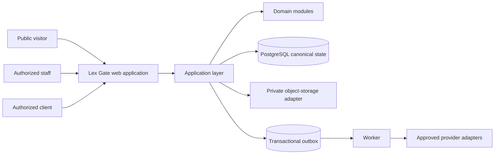

# System Context and Architecture

**Document ID:** LG-ARC-001  
**Status:** Approved conceptual baseline; provider selection pending  
**Owner:** Architecture lead

## Context

## Architecture rules

- The web and worker applications are deployment units, not independent business systems.
- `packages/domain` contains types, invariants, commands, and domain events with no Next.js, database, or provider imports.
- `packages/application` coordinates authorization, transactions, projections, and ports.
- `packages/database`, `integrations`, `auth`, and `observability` implement ports at the boundary.
- PostgreSQL is canonical state. Files belong in private object storage, and only metadata and immutable references belong in relational state.
- Side effects are committed through an outbox, workers may retry delivery but do not silently rewrite domain facts.

## Trust boundaries

Public content, authenticated internal work, client portal, restricted matters, workers, providers, and production administration are separate trust zones. Each resource operation is authenticated, authorized, logged at an appropriate classification, and minimized to its needed data.

## Technology baseline

Node 22, TypeScript, pnpm workspaces, Turborepo, Next.js App Router, PostgreSQL, Drizzle migrations, local MinIO, Docker Compose, Vitest, Playwright, and GitHub Actions form the M0 baseline. Cloud, region, identity, WAF, provider, and monitoring vendors remain ODR-005/006 decisions.
